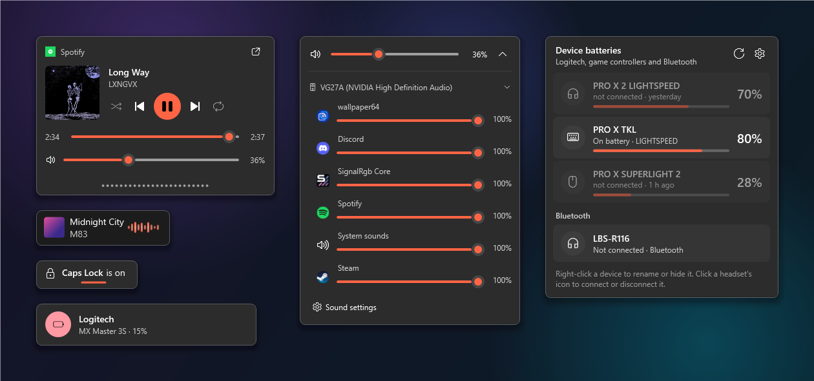
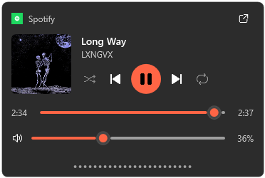
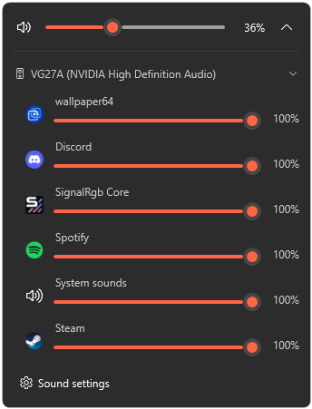
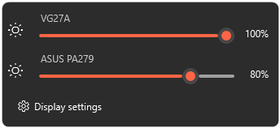
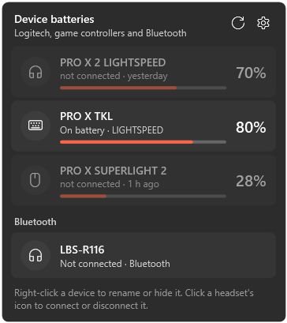
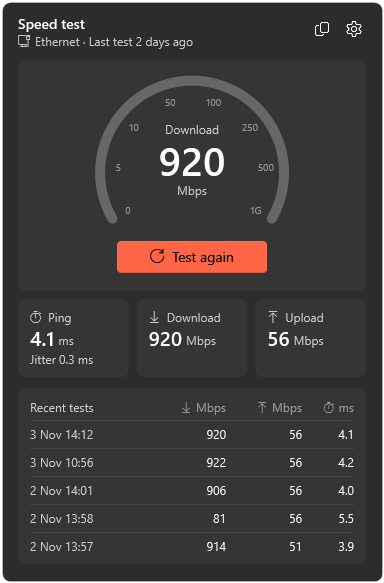
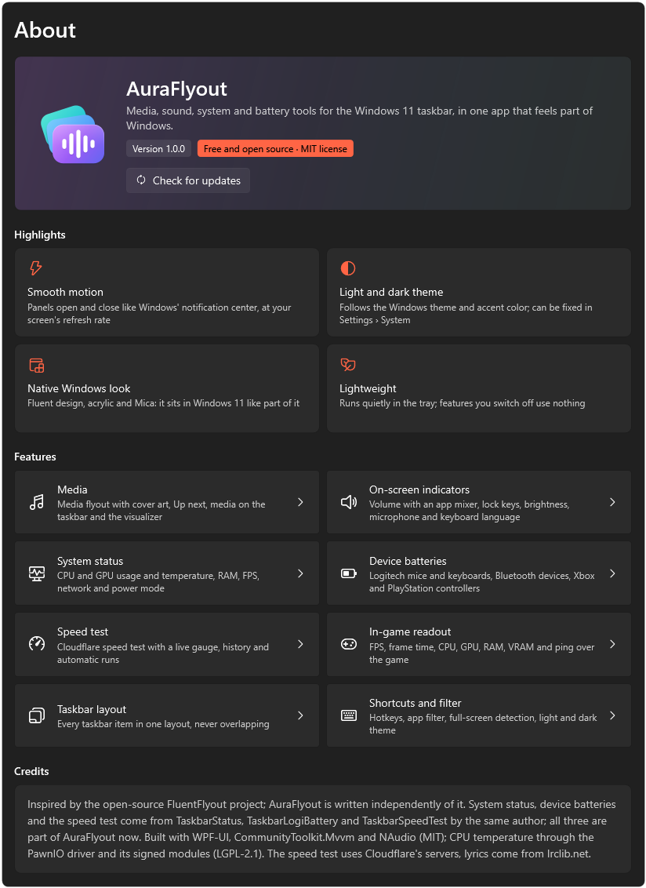

<div align="center">


# AuraFlyout

**Media, volume, system and battery tools for the Windows 11 taskbar, in one app that feels like part of Windows.**

[](#requirements)
[](https://dotnet.microsoft.com/download/dotnet/10.0)
[](LICENSE)
[](#türkçe)

<picture>
  <source media="(prefers-color-scheme: dark)" srcset="docs/showcase-dark.png">
  <source media="(prefers-color-scheme: light)" srcset="docs/showcase-light.png">
  
</picture>

</div>

AuraFlyout replaces the Windows volume, brightness and lock key indicators with Fluent flyouts, puts a media widget
and a live visualizer on the taskbar, and brings three of my earlier taskbar apps under one roof:
[TaskbarStatus](https://github.com/batuhanbecel/TaskbarStatus),
[TaskbarLogiBattery](https://github.com/batuhanbecel/TaskbarLogiBattery) and
[TaskbarSpeedTest](https://github.com/batuhanbecel/TaskbarSpeedTest). Everything is free and every feature is included.

## Highlights

- **Smooth motion.** Panels open and close like the notification center does, at your screen's refresh rate.
- **Light and dark theme.** It follows the Windows theme and accent color, or you can pick one.
- **Native look.** Fluent design, acrylic flyouts and a Mica settings window.
- **Lightweight.** It runs quietly in the tray. Features you switch off don't use any resources.

## Features

### Media



- **Media flyout** with cover art, title, artist, playback controls, seek bar, shuffle and repeat. It opens on media
  keys, from the tray icon or with a shortcut.
- **Time-synced lyrics** under the controls (from [LRCLIB](https://lrclib.net)).
- **Cover glow** tints the flyout with a soft version of the album art.
- **Up next** shows the new track for a moment when the song changes on its own.
- **Media on the taskbar:** cover, title and controls in the taskbar. A click opens the flyout, the wheel changes the
  volume and a middle-click plays or pauses.
- **Visualizer:** live spectrum bars next to the song title or beside the widget (WASAPI loopback, nothing is
  recorded).
- **App filter** to keep chosen players out of AuraFlyout.


<br clear="right">

### Volume and on-screen indicators



- **Volume flyout** instead of the Windows overlay. AuraFlyout handles the volume keys itself, so the Windows overlay
  never shows up.
- **App mixer** with a volume slider for each app and a switch for the output device. Apps that are playing sound are
  highlighted.
- **The taskbar's speaker icon** opens the mixer instead of Quick Settings, and the wheel over it changes the volume.
  The network icon still opens Quick Settings.
- **Lock keys:** Caps Lock, Num Lock, Scroll Lock and Insert.
- **Brightness** for laptop screens and for external monitors over DDC/CI.
- **Microphone:** a mute shortcut, plus an icon on the taskbar while the microphone is muted.
- **Keyboard language:** shows the new language and layout after Win + Space.

&nbsp;


<br clear="right">

### Taskbar widgets

<p>
  &nbsp;
  
</p>

- **System status** (formerly TaskbarStatus): CPU and GPU usage and temperature, RAM, FPS, network, disk, VRAM and ping,
  in the same font as the clock. Click it for a details panel with graphs and the Windows power mode, or double-click it
  for Task Manager. You can turn on alerts for high temperatures or a full memory.
- **Device batteries** (formerly TaskbarLogiBattery): Logitech mice, keyboards and headsets over HID++ 2.0 and Centurion
  (no G HUB needed), Xbox and PlayStation controllers, and Bluetooth devices. You get notifications on connect,
  disconnect, low battery and full charge. Click a headset's icon to connect or disconnect it.
- **Speed test** (formerly TaskbarSpeedTest): download, upload, ping and jitter against Cloudflare's network. It has a
  live gauge, keeps the last 20 results (you can copy them as CSV) and can run tests on a schedule.
- **Taskbar layout:** every widget sits in a left, center or right zone. You set the order once, and widgets never
  overlap.

### In-game readout

FPS, frame time, CPU, GPU, RAM, VRAM and ping in a corner over full-screen and borderless games. Clicks pass through it
and it never takes focus. Toggle it with `Ctrl + Alt + O`.

### Settings



- Searchable settings with one page per feature.
- Global shortcuts: `Ctrl + Alt + V` for the mixer, `Ctrl + Alt + M` for the microphone, `Ctrl + Alt + B` for
  brightness and `Ctrl + Alt + O` for the overlay. All of them can be changed.
- Flyout position, display time, size, material (Fluent acrylic, classic acrylic or solid) and background density.
- Pause in full screen, choice of monitor, English and Turkish interface.
- Export and import of your settings, and a per-user install with updates from GitHub releases.

## Install

1. Download `AuraFlyout.exe` from [Releases](../../releases).
2. Run it. It works as a portable app.
3. Optionally, use *System › Installation › Install* for a Start menu entry and an uninstaller. This needs no
   administrator rights.

Updates are checked against this repository's releases and verified with SHA-256 before they are installed.

### Requirements

- Windows 11. Windows 10 19041 or later runs AuraFlyout, but it is designed for 11.
- [.NET 10 Desktop Runtime](https://dotnet.microsoft.com/download/dotnet/10.0) (x64).

### Administrator mode

The CPU temperature (through the [PawnIO](https://pawnio.eu) driver) and FPS (through ETW) need administrator rights.
*System › Run as administrator* registers a scheduled task, so later starts don't show a UAC prompt. Without PawnIO,
the temperature comes from HWiNFO, LibreHardwareMonitor or the ACPI thermal zone.

### Coming from TaskbarStatus, TaskbarLogiBattery or TaskbarSpeedTest

On the first start, AuraFlyout imports their settings, Logitech device names and speed test history. If the old apps
are still running, the Home page offers to close them and remove their autostart entries.

## Privacy

AuraFlyout has no telemetry. It only connects to the network for these:

| Feature | Connects to | What is sent |
| --- | --- | --- |
| Lyrics (can be turned off) | lrclib.net | Artist, title, album and length of the song |
| Speed test | Cloudflare speed test servers | Test traffic only |
| Ping reading | 1.1.1.1 | A small packet every two seconds, only while ping is shown |
| Updates (can be turned off) | api.github.com | A request for the latest release |

The visualizer reads the sound output on your PC only. It doesn't record or send any audio.

## Build

You need the [.NET 10 SDK](https://dotnet.microsoft.com/download/dotnet/10.0).

```bat
build.bat
```

This publishes a single-file `publish\AuraFlyout.exe`. For a debug build, run:

```bash
dotnet build src/AuraFlyout/AuraFlyout.csproj -c Debug
```

| Command line | |
| --- | --- |
| `AuraFlyout.exe --tray` | Starts without opening the settings window (used by autostart) |
| `AuraFlyout.exe --exit` | Closes the running instance cleanly |
| `AuraFlyout.exe --render-previews <folder> [--lang en\|tr] [--theme dark\|light]` | Renders every flyout and settings page to PNG (used for the images above) |

AuraFlyout keeps its settings and log in `%AppData%\AuraFlyout\`.

<details>
<summary>Project structure</summary>

```
src/AuraFlyout/
  App.xaml(.cs)          startup, single instance, tray, docks, admin mode
  Assets/                app icon (vector source and renderer)
  Audio/                 volume and mixer, loopback spectrum, Windows OSD handling
  Controls/              setting cards, charts, spectrum bars, motion helpers
  Core/                  settings, Win32, keyboard hook, theme, backdrops, startup, import
  Flyouts/               media, volume, lock keys, brightness, panels and toasts
  Media/                 media sessions (GSMTC), app names and icons, lyrics
  Modules/SystemStatus/  sensors, PawnIO, ETW FPS (from TaskbarStatus)
  Modules/LogiBattery/   HID, HID++ 2.0, Centurion (from TaskbarLogiBattery)
  Modules/SpeedTest/     Cloudflare speed test engine (from TaskbarSpeedTest)
  Modules/Bluetooth/     Bluetooth batteries, headset connect / disconnect
  Modules/Gamepad/       Xbox and PlayStation controller batteries
  Overlay/               in-game readout
  Settings/              settings window and pages
  Taskbar/               taskbar widgets and their shared layout
  Resources/             styles, English and Turkish strings
```

</details>

## Credits

- Inspired by the open-source [FluentFlyout](https://github.com/unchihugo/FluentFlyout). AuraFlyout doesn't copy its
  code; it was written independently.
- [WPF-UI](https://github.com/lepoco/wpfui), [CommunityToolkit.Mvvm](https://github.com/CommunityToolkit/dotnet) and
  [NAudio](https://github.com/naudio/NAudio) (MIT).
- [PawnIO](https://pawnio.eu) modules `AMDFamily17.bin` and `IntelMSR.bin` (LGPL-2.1, see
  `src/AuraFlyout/Modules/SystemStatus/PawnIO/COPYING`).
- Lyrics come from [LRCLIB](https://lrclib.net).

## License

[MIT](LICENSE) © 2026 Batuhan Becel

---

## Türkçe

AuraFlyout, Windows 11 görev çubuğu için medya, ses, sistem ve pil araçlarını tek bir uygulamada toplar. Windows'un ses,
parlaklık ve kilit tuşu göstergelerinin yerine Fluent tasarımlı flyout'lar koyar. Görev çubuğuna medya widget'ı ve
canlı görselleştirici ekler. Daha önceki TaskbarStatus, TaskbarLogiBattery ve TaskbarSpeedTest uygulamalarım da artık
AuraFlyout'un parçası. Tamamen ücretsizdir ve tüm özellikler dahildir.

**Öne çıkanlar**

- **Medya:** kapaklı medya flyout'u, zamanlı şarkı sözleri, kapak parıltısı ve "Sıradaki" kartı. Görev çubuğunda medya
  widget'ı ve görselleştirici de var.
- **Ses ve göstergeler:** Windows göstergesinin yerine ses flyout'u ve uygulama başına mikser. Görev çubuğundaki ses
  simgesi mikseri açar. Kilit tuşları, parlaklık (DDC/CI dahil), mikrofon ve klavye dili için de gösterge var.
- **Görev çubuğu widget'ları:** sistem durumu (CPU/GPU kullanımı ve sıcaklığı, RAM, FPS, ağ, disk, VRAM, ping), cihaz
  pilleri (Logitech, Xbox/PlayStation kolları, Bluetooth) ve Cloudflare hız testi. Widget'lar tek bir düzende dizilir,
  üst üste binmez.
- **Oyun içi gösterge:** oyunun üstünde FPS, kare süresi, CPU, GPU, RAM, VRAM ve ping.
- **Ayarlar:** aranabilir ayarlar, genel kısayollar, açık/koyu tema, Türkçe ve İngilizce arayüz, ayarları dışa ve içe
  aktarma, kullanıcıya özel kurulum ve GitHub'dan güncelleme.

**Kurulum**

1. [Sürümler](../../releases) sayfasından `AuraFlyout.exe` dosyasını indirin.
2. Dosyayı çalıştırın. Uygulama taşınabilir olarak çalışır.
3. İsterseniz *Sistem › Kurulum › Kur* ile Başlat menüsü kısayolu ve kaldırma girişi ekleyin. Bunun için yönetici izni
   gerekmez.

[.NET 10 Masaüstü Çalışma Zamanı](https://dotnet.microsoft.com/download/dotnet/10.0) gerekir.

**Yönetici modu**

CPU sıcaklığı ([PawnIO](https://pawnio.eu)) ve FPS için yönetici izni gerekir. *Sistem › Yönetici olarak çalıştır*
bir zamanlanmış görev oluşturur. Sonraki açılışlarda UAC sorulmaz.

**Gizlilik**

AuraFlyout telemetri göndermez. Ağa yalnızca şu durumlarda bağlanır:

- şarkı sözleri için lrclib.net'e (sanatçı, şarkı, albüm ve süre gönderilir);
- hız testi için Cloudflare'e;
- ping için 1.1.1.1'e;
- güncelleme denetimi için GitHub'a.

Görselleştirici sesi yalnızca bilgisayarınızda işler. Hiçbir sesi kaydetmez ya da göndermez.

**Derleme:** .NET 10 SDK ile `build.bat` komutunu çalıştırın. Çıktı `publish\AuraFlyout.exe` dosyasıdır.
